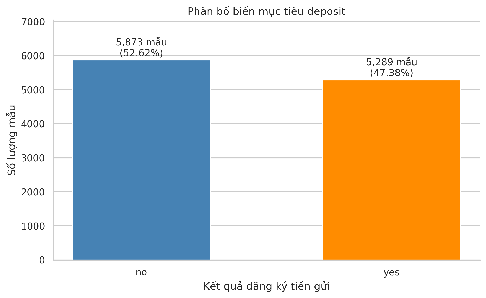
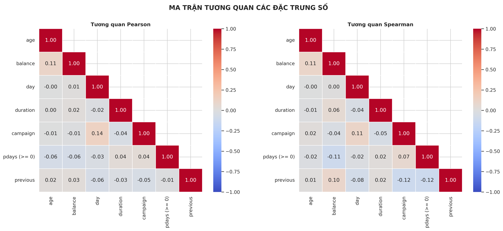
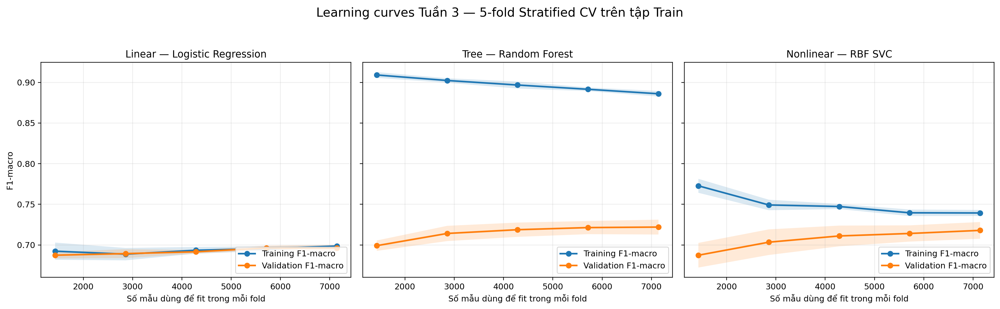
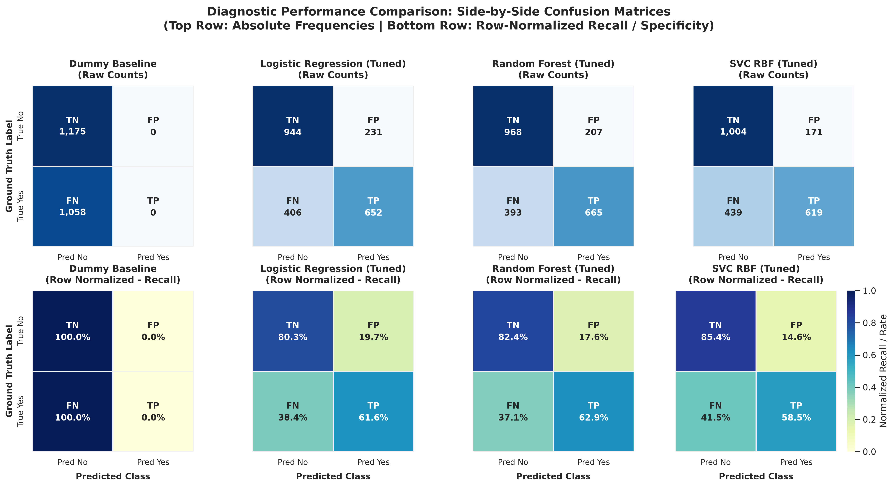
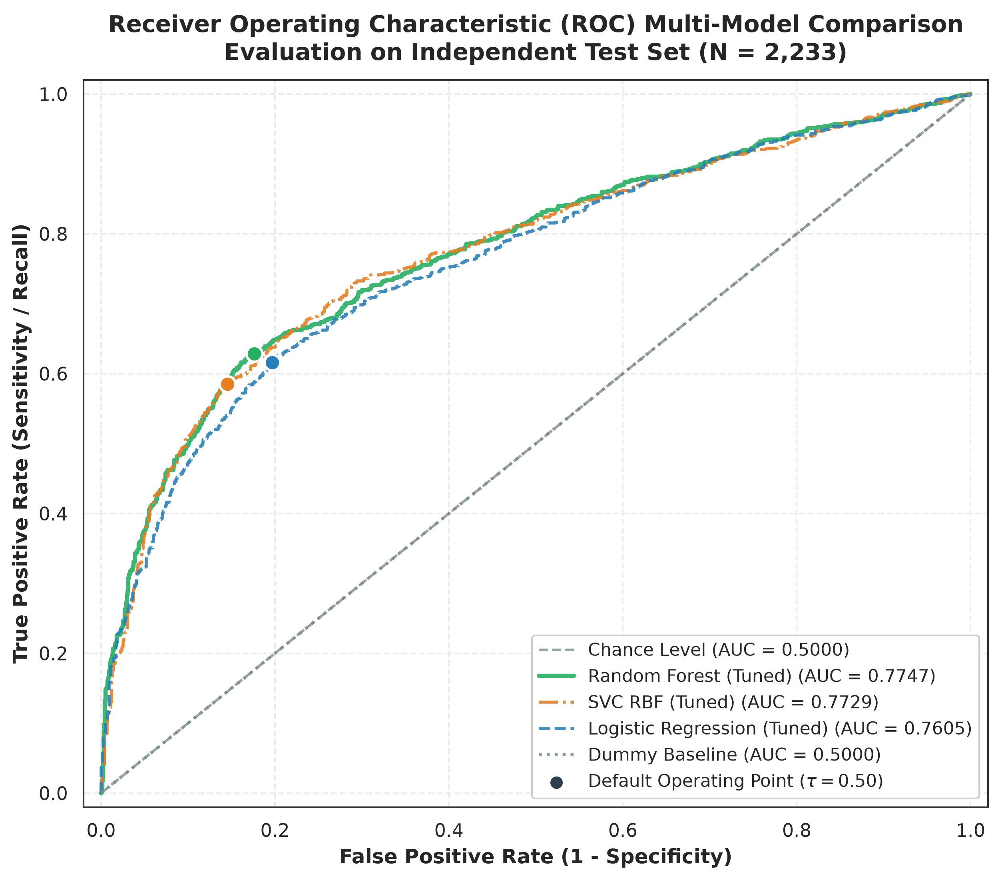
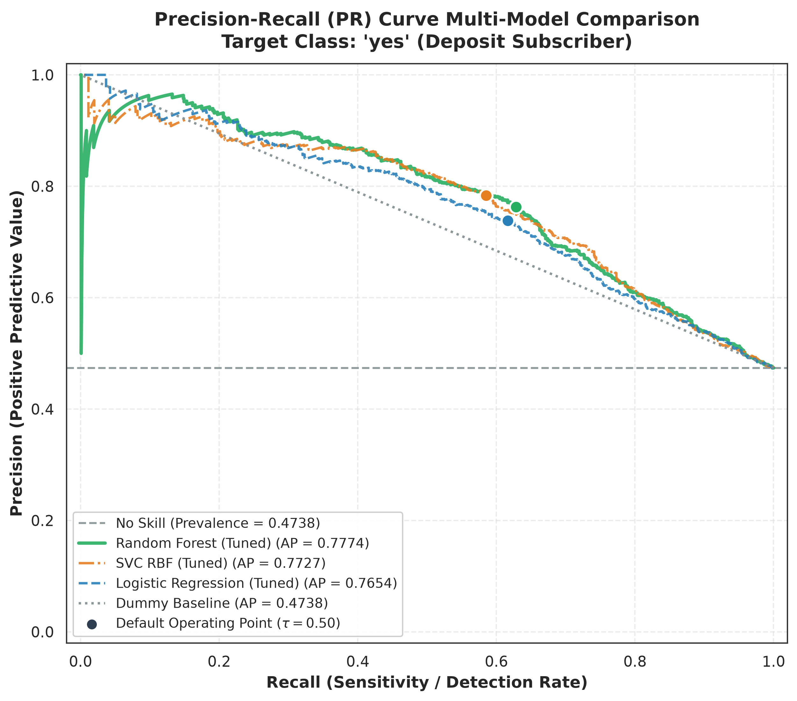

# Dự đoán đăng ký tiền gửi có kỳ hạn

BÁO CÁO BÀI TẬP LỚN MACHINE LEARNING

Bank Marketing • Quy trình từ dữ liệu đến suy luận

| Thành viên | MSSV | Đóng góp chính |
|---|---|---|
| Phan Ngọc Xuân Lợi | 2411969 | Khảo sát bài toán, cleaning, Logistic Regression, metrics, CLI và web |
| Ngô Minh Trí | 2313598 | Chất lượng dữ liệu, encoding, Random Forest, diagnostic plots, môi trường |
| Đỗ Phúc Danh | 2310409 | Phân bố dữ liệu, SVC, error analysis, slide và kịch bản |
| Phan Ký Nhân | 2412432 | Quan hệ đa biến, tích hợp pipeline, feature engineering thay Danh ở Tuần 2, CV, learning curves, benchmark và nghiệm thu |

Ngày hoàn thiện: 05 tháng 11 năm 2026

## Tóm tắt

Nhóm xây dựng hệ thống phân loại khách hàng đăng ký tiền gửi có kỳ hạn trên phiên bản Bank Marketing gồm 11.162 bản ghi, 16 thuộc tính đầu vào và nhãn deposit. Mục tiêu là hỗ trợ ưu tiên liên hệ trước cuộc gọi, không thay thế quyết định nghiệp vụ. Pipeline loại duration, chia dữ liệu phân tầng 80/20, làm sạch, sinh 24 đặc trưng và chọn 32 đặc trưng bằng Mutual Information. Ba họ thuật toán gồm Logistic Regression, Random Forest và SVC kernel RBF.

Trên 2.233 mẫu kiểm thử, Random Forest đạt Macro-F1 0,7263, Recall lớp yes 0,6285 và ROC-AUC 0,7747. Nhóm đề xuất mô hình này cho chấm điểm theo lô, đồng thời ghi nhận dung lượng 41,50 MB và mức giải thích hạn chế hơn tuyến tính. Trạng thái Champion vẫn là khuyến nghị tạm thời, chưa có biên bản xác nhận cả nhóm.

Kiểm thử độc lập xác nhận dữ liệu thô qua pipeline đã lưu tái tạo đúng ma trận Test và các chỉ số báo cáo. Tuy vậy, CV lịch sử thực hiện sau khi chọn đặc trưng trên toàn bộ Train; vì vậy CV và learning curves có nguy cơ lạc quan do thông tin giữa các fold. Báo cáo phân biệt hạn chế đó với việc tập Test không tham gia fit. Không dùng chênh lệch CV–Test nhỏ để chứng minh mô hình không overfit.

<!-- page -->
# Mục lục

1. Giới thiệu bài toán

2. Dữ liệu và tiền xử lý

3. Mô hình và phương pháp

4. Thực nghiệm và kết quả

5. Thảo luận đánh đổi và phân tích lỗi

6. Kết luận và hướng phát triển

Phụ lục A. Danh mục 24 đặc trưng

Phụ lục B. Tái lập và nguồn bằng chứng

Tài liệu tham khảo

## Phạm vi và nguồn bằng chứng

Báo cáo tích hợp notebook EDA của Trí và Danh, phân tích tương quan của Nhân, các mô-đun preprocessing của Lợi và Trí, ba mô hình của Lợi, Trí, Danh, cùng các bảng đánh giá và phân tích lỗi Tuần 4. Đóng góp gốc giữ trong reports/; bảng số liệu chính lấy từ evaluation_benchmark.csv và được kiểm tra lại bằng artifact hiện có. Benchmark sử dụng bản ghi tại baseline c0ae203 và ghi rõ môi trường; thời gian đo không phải cam kết tốc độ triển khai.

Notebook Tuần 3 được khôi phục từ commit 2f94d03 đã tồn tại trên nhánh cục bộ. Các lần thực thi phục vụ nghiệm thu là tái lập hiện tại; không thay thế lịch sử tuning, không tạo thời gian huấn luyện giả và không ghi đè các model gốc.

Nguồn phân công năm tuần là tài liệu “Bản sao của BTL_ML.md” lưu cùng tài liệu học phần của nhóm. Báo cáo và gói nộp theo cấu trúc của tài liệu này. Mẫu tên ZIP dùng thứ tự Person 1 đến Person 4 theo bảng thành viên; giới hạn dung lượng của cổng nộp bài chưa được tài liệu cung cấp.

<!-- page -->
# 1 Giới thiệu bài toán

## 1.1 Bối cảnh và mục tiêu

Ngân hàng có thể liên hệ nhiều khách hàng để giới thiệu tiền gửi có kỳ hạn. Mỗi cuộc gọi sử dụng thời gian nhân viên, còn phản ứng của khách hàng phụ thuộc tình trạng tài chính, khoản vay, lịch sử liên hệ và bối cảnh chiến dịch. Phân loại tự động giúp sắp xếp danh sách để cán bộ xem xét, thay vì gọi ngẫu nhiên hoặc áp dụng một vài quy tắc cố định.

Đơn vị dự đoán là một bản ghi liên hệ trong dữ liệu, không phải một khách hàng duy nhất đã được xác minh. Biến mục tiêu deposit có hai giá trị yes và no. Nhãn yes biểu thị đăng ký tiền gửi; đây là lớp dương trong Precision và Recall. Mô hình trả nhãn dự đoán và điểm số phù hợp với khả năng của từng estimator. Điểm predict_proba của Random Forest chưa được hiệu chỉnh xác suất và không bảo đảm tỷ lệ chuyển đổi ngoài thực tế.

## 1.2 Thông tin có tại thời điểm dự đoán

duration là thời lượng cuộc gọi hiện tại nên không sẵn có trước cuộc gọi. Pipeline chủ động loại cột này dù nó có liên hệ mạnh với nhãn. Những trường như campaign, day, month và contact cần được hệ thống nghiệp vụ cung cấp như thông tin đã biết hoặc lịch liên hệ được lên kế hoạch ở thời điểm chấm điểm. Dữ liệu ghi nhận chiến dịch lịch sử; không đủ bằng chứng rằng mọi trường đều có sẵn ở thời điểm bắt đầu một chiến dịch mới. Phạm vi triển khai vì thế cần xác nhận với nghiệp vụ, đặc biệt khi dùng campaign như số lần liên hệ tích lũy.

## 1.3 Vì sao dùng Machine Learning

Logistic Regression cung cấp mốc tuyến tính dễ giải thích, Random Forest biểu diễn tương tác và ngưỡng phi tuyến, còn SVC RBF mô hình hóa ranh giới linh hoạt trong không gian đặc trưng. So sánh các họ thuật toán giúp đánh giá liệu độ phức tạp bổ sung có đem lại cải thiện dự đoán và có phù hợp với giới hạn vận hành hay không. Dummy most-frequent làm mốc tối thiểu để phát hiện kết quả có vẻ tốt chỉ vì phân bố lớp.

Tiêu chí chính là Macro-F1 nhằm đánh trọng số bằng nhau cho hai lớp. Precision, Recall, ROC-AUC và Average Precision bổ sung thông tin về gọi nhầm, bỏ sót và chất lượng xếp hạng. Không sử dụng độ chính xác đơn lẻ như bằng chứng đủ cho giá trị nghiệp vụ.

<!-- page -->
# 2 Dữ liệu và tiền xử lý

## 2.1 Nguồn và cấu trúc

Tệp đóng gói là data/raw/bank.csv, 11.162 dòng × 17 cột; nhãn là deposit. Đây là phiên bản được nhóm sử dụng và README dẫn tới Kaggle Bank Marketing của janiobachmann. Nó không phải nguyên trạng bank-full.csv gồm 45.211 dòng của UCI [1]. Khi tái lập phải dùng đúng tệp đi kèm, không thay bằng một tệp cùng tên tải từ UCI. SHA-256 của tệp được ghi trong báo cáo nghiệm thu và manifest gói nộp.

| Nhóm | Các thuộc tính |
|---|---|
| Thông tin cá nhân | age, job, marital, education |
| Tài chính | default, balance, housing, loan |
| Liên hệ hiện tại | contact, day, month, duration, campaign |
| Lịch sử chiến dịch | pdays, previous, poutcome |
| Mục tiêu | deposit: no = 5.873; yes = 5.289 |

Không có dòng trùng toàn bộ và không có ô NaN trong CSV gốc. Điều này không đồng nghĩa không thiếu thông tin: unknown xuất hiện ở poutcome 8.326 dòng (74,59%), contact 2.346 (21,02%), education 497 (4,45%) và job 70 (0,63%). pdays = −1 là sentinel chưa liên hệ trước, xuất hiện 8.324 lần. balance âm có thể biểu thị thấu chi nên không được coi mặc định là dữ liệu sai.

## 2.2 Các thách thức trọng tâm

Bốn thách thức có bằng chứng là rò rỉ thời gian từ duration, unknown và sentinel cần xử lý theo ý nghĩa, phân bố lệch với ngoại lai ở biến tiền/số lần liên hệ, và các quan hệ phi tuyến hoặc tương tác giữa thuộc tính. Lớp yes chiếm 47,38% trong mẫu nên không mô tả bài toán này là mất cân bằng 9:1. Mức 47,38% cũng không phải ước lượng tỷ lệ đăng ký của mọi chiến dịch ngân hàng.

<!-- page -->
## 2.3 Quan hệ đa biến và giới hạn diễn giải

Notebook 03_relationships.ipynb phân biệt biến số đo với mã danh mục. Pearson/Spearman dùng cho các biến số phù hợp; các danh mục danh nghĩa không được gán ID tùy tiện rồi diễn giải Pearson. Khi xét pdays và previous, trạng thái chưa liên hệ và phân bố nhiều số 0 phải được xem cùng hệ số tương quan. Phân tích feature–target và so sánh theo lớp là mô tả association, không phải bằng chứng nhân quả.

Ngưỡng |r| ≥ 0,8 trong notebook chỉ là quy tắc sàng lọc cặp biến mạnh, không phải định luật. Các biến sinh thêm như age_squared, log(balance) và các cờ liên hệ có thể cùng phản ánh một nguồn thông tin. Mutual Information top-K không bảo đảm loại hết đa cộng tuyến hoặc dư thừa. Vì vậy hệ số của mô hình tuyến tính cần được diễn giải trong tập biến đã mã hóa và chọn lọc, không như tác động độc lập ngoài đời.

## 2.4 Chia dữ liệu và làm sạch

split_data dùng train_test_split, stratify theo deposit, test_size = 0,2 và random_state = 42. Train có 8.929 dòng (4.698 no, 4.231 yes), Test có 2.233 dòng (1.175 no, 1.058 yes). Kiểm tra độc lập xác nhận index hai tập không giao nhau và danh sách index dùng fit schema guard đúng bằng Train.

StringCleaner chuẩn hóa chuỗi và admin.; MissingHandler thay unknown bằng missing, dùng median hoặc mean học trên Train cho ô số thiếu; OutlierClipper dùng biên IQR của Train và giữ sentinel pdays = −1. Các ngưỡng là lựa chọn kỹ thuật. Ví dụ biên balance là [−2.236; 4.052], campaign [0; 6], previous [0; 2,5]. Clipping previous có thể tạo giá trị phân số dù biến gốc là số đếm: đây là hạn chế của biến đổi lịch sử, không phải số lần liên hệ thực. Báo cáo giữ model hiện có và ghi nhận vấn đề thay vì thay preprocessing sau khi model đã fit.

<!-- page -->
## 2.5 Kỹ thuật đặc trưng và mã hóa

Danh mục 24 đặc trưng do phần việc Danh/Nhân ở Tuần 2 triển khai bao gồm biến tuổi, log số dư dương/âm, cờ khoản vay, lịch sử liên hệ, tương tác chiến dịch và chu kỳ tháng. Công thức đầy đủ ở Phụ lục A và src/feature_engineering.py. Chúng không dùng deposit hoặc duration. Kết quả suy luận cần đúng cùng cleaning trước feature engineering vì công thức áp dụng lên giá trị đã làm sạch và cắt ngưỡng.

education dùng thứ bậc primary < secondary < tertiary, giá trị ngoài danh mục nhận −1. Các biến danh nghĩa dùng One-Hot với handle_unknown='ignore'. RobustScaler áp dụng cho nhóm lệch; StandardScaler cho age/day. Ngưỡng age_group và chu kỳ tháng là thiết kế miền, không phải thông số tối ưu bằng Test.

| Giai đoạn | Số cột |
|---|---:|
| Thuộc tính thô | 16 |
| Sau loại duration | 15 |
| Sau thêm 24 đặc trưng | 39 |
| Sau encoding và scaling | 74 |
| Sau chọn Mutual Information | 32 |

## 2.6 Pipeline và chống rò rỉ

Thứ tự thực thi là SchemaGuard → StringCleaner → MissingHandler → OutlierClipper → FeatureEngineer → ColumnTransformer → MutualInformationSelector. Tất cả thống kê fit sau khi chia Train/Test. y_train chỉ vào bộ chọn MI; không dùng y_test để fit. K = 32 là ngân sách kỹ thuật định trước, không phải ngưỡng khoa học. Chỉ một chiến lược feature selection được dùng.

Kiểm thử nghiệm thu biến đổi toàn bộ Train và Test từ CSV bằng pipeline đã lưu, so khớp với Parquet theo thứ tự cột và từng giá trị. Nhãn thô cũng khớp từng dòng với nhãn đã lưu. Mọi giá trị đều hữu hạn, không có target hoặc duration trong 32 cột. CLI loại deposit nếu người dùng gửi kèm và không để duration ảnh hưởng dự đoán.

Giới hạn quan trọng: pipeline trên được fit một lần trước CV của Tuần 3. Các fold validation trong Train vì vậy đã góp vào thống kê và MI. Điều này không làm Test tham gia fit, nhưng làm CV không còn là ước lượng độc lập của toàn bộ pipeline [2]. Không thể định lượng độ lạc quan chỉ bằng gap CV–Test; cần một thí nghiệm mới với pipeline nằm bên trong từng fold.

<!-- page -->
# 3 Mô hình và phương pháp

## 3.1 Thiết lập thực nghiệm

Các mô hình dùng ma trận Train 8.929 × 32; StratifiedKFold có 5 fold, shuffle=True, random_state=42; scoring='f1_macro'. Tuning utility của Nhân dùng GridSearchCV/RandomizedSearchCV theo lựa chọn của caller. Ba đóng góp hiện có dùng grid search. Ma trận đầu vào nhất quán, nhưng CV có giới hạn đã nêu ở Mục 2.6 và không phải nested CV. Điểm best-CV sau tìm kiếm tham số còn chịu thiên lệch lựa chọn.

## 3.2 Logistic Regression của Lợi

Lợi so sánh Dummy most-frequent, Logistic Regression mặc định và mô hình tuyến tính tuned. Artifact có C = 10, penalty L1. Mô hình dễ kiểm tra hệ số nhưng biểu diễn cộng tính trên các đặc trưng được cung cấp. CV của bản tuned là 0,6960, thấp hơn default 0,6990. Nhóm giữ cả hai số và không tuyên bố tuning cải thiện tuyến tính. Thời gian grid search và fit cuối không được lưu nên ghi N/A.

## 3.3 Random Forest của Trí

Random Forest kết hợp nhiều cây, có thể biểu diễn tương tác và ngưỡng phi tuyến. Cấu hình artifact là 300 cây, max_depth = 20, min_samples_split = 10, random_state = 42. CV default 0,7124 và tuned 0,7233. Global feature importance có sẵn, nhưng không diễn giải được nhân quả và có thể phân chia ảnh hưởng giữa các biến tương quan.

## 3.4 SVC RBF của Danh

Danh dùng kernel RBF, điều chỉnh C và gamma. Cấu hình tốt nhất được ghi nhận là C = 100, gamma = 0,01; CV 0,7178 so với default 0,6960. Grid search gồm 33 cấu hình theo báo cáo. Thời gian khoảng 320 giây và fit toàn Train 5,684 giây là số đã được Danh ghi nhận, không phải phép đo mới trên máy nghiệm thu. SVC này không bật probability; đầu ra decision_function là margin.

| Mô hình | CV default | CV tuned | Std tuned |
|---|---:|---:|---:|
| Logistic Regression | 0,6990 | 0,6960 | 0,0040 |
| Random Forest | 0,7124 | 0,7233 | 0,0096 |
| SVC RBF | 0,6960 | 0,7178 | 0,0104 |

Bảng 1. CV lịch sử trên đặc trưng đã xử lý; std là độ lệch chuẩn giữa fold, không phải khoảng tin cậy. Dummy đạt 0,3448.

Lần tái lập nghiệm thu 05/11/2026 khớp các điểm tuned đến bốn chữ số. Logistic mặc định cho 0,6995 thay vì 0,6990 lịch sử. Kiểm tra riêng ghi nhận cả năm fold đều đạt giới hạn 100 vòng lặp và phát ConvergenceWarning; baseline mặc định chưa hội tụ, không phải cấu hình tuyến tính đã tối ưu. Chưa xác định riêng nguyên nhân chênh lệch số lịch sử. Không sửa lại số lịch sử hoặc coi hai lần thực thi là một thí nghiệm.

<!-- page -->
## 3.5 Learning curves của Nhân

Learning curves dùng clone của ba model đã chọn, năm tỷ lệ dữ liệu từ 20% đến 100% trong mỗi fold và cùng quy ước CV. Tập held-out Test không được nạp. Notebook khôi phục tái lập biểu đồ trong thư mục tạm để bảo vệ artifact lịch sử.

| Họ mô hình | Train ở mốc cuối | Validation | Train − validation |
|---|---:|---:|---:|
| Logistic Regression | 0,6986 | 0,6961 | 0,0024 |
| Random Forest | 0,8860 | 0,7220 | 0,1641 |
| SVC RBF | 0,7393 | 0,7179 | 0,0214 |

Bảng 2. Số lịch sử được lưu trong báo cáo Tuần 3; chênh lệch tính trước làm tròn.

Logistic có hai đường gần nhau ở mức thấp hơn hai mô hình phi tuyến, phù hợp với dấu hiệu bias hoặc giới hạn biểu diễn. Random Forest có gap train–validation lớn, cho thấy variance vẫn là vấn đề dù điểm Test đứng đầu. SVC có gap nhỏ hơn và validation còn tăng nhẹ ở mốc cuối. Không khẳng định dữ liệu mới chắc chắn cải thiện bằng một đường cong này.

Do MI đã dùng toàn bộ Train, cả các tập con trên learning curve và validation không độc lập hoàn toàn với khâu chọn biến. Những đường cong này mô tả hành vi của model trên biểu diễn lịch sử cố định. Thí nghiệm đánh giá toàn bộ hệ thống cần fit lại preprocessing và MI bên trong mỗi fold và mỗi tập con.

<!-- page -->
# 4 Thực nghiệm và kết quả

## 4.1 Định nghĩa chỉ số

Với lớp yes, Precision = TP/(TP+FP), Recall = TP/(TP+FN), F1 = 2TP/(2TP+FP+FN). Macro-F1 là trung bình F1 của lớp yes và lớp no. ROC-AUC đo chất lượng xếp hạng trên các ngưỡng. Trường Test_PR_AUC trong CSV của nhóm được tính bằng average_precision_score, tức Average Precision (AP), không phải tích phân hình thang của đường PR [3].

Gap = CV Macro-F1 − Test Macro-F1. Gap âm nghĩa điểm Test cao hơn CV trong phép chia hiện tại, không chứng minh không overfit. Precision/Recall dưới đây dùng nhãn model.predict: với Logistic/RF tương ứng ngưỡng xác suất 0,5; với SVC là margin 0. Sigmoid của margin trong bảng lịch sử là điểm xếp hạng chưa hiệu chỉnh, không phải xác suất.

| Mô hình | Macro-F1 | Accuracy | Precision yes | Recall yes | ROC-AUC | AP |
|---|---:|---:|---:|---:|---:|---:|
| Dummy | 0,3448 | 0,5262 | 0,0000 | 0,0000 | 0,5000 | 0,4738 |
| Logistic | 0,7098 | 0,7147 | 0,7384 | 0,6163 | 0,7605 | 0,7654 |
| Random Forest | 0,7263 | 0,7313 | 0,7626 | 0,6285 | 0,7747 | 0,7774 |
| SVC RBF | 0,7185 | 0,7268 | 0,7835 | 0,5851 | 0,7729 | 0,7727 |

Bảng 3. Đánh giá do Lợi triển khai, kiểm tra độc lập bằng model hiện có trên cùng 2.233 mẫu Test. Gap LR/RF/SVC lần lượt −0,0137; −0,0030; −0,0007.

<!-- page -->
## 4.2 Đồ thị chẩn đoán

Random Forest có ROC-AUC và AP lớn nhất, nhưng chênh lệch với SVC nhỏ. Không chọn ngưỡng sản xuất bằng Test. Mốc 0,41 từng được trình bày trong slide là quan sát hậu nghiệm, cần kiểm chứng trên validation độc lập nếu dùng cho vận hành. Báo cáo này giữ quyết định model.predict hiện tại; không tuning thêm theo Test hoặc thay model đã lưu.

<!-- page -->
# 5 Thảo luận đánh đổi và phân tích lỗi

## 5.1 So sánh đánh đổi

Benchmark của Nhân dùng predict trên 32 cột đã xử lý, không lặp preprocessing. Quy trình có 25 warm-up + 200 lần đơn mẫu, 3 warm-up + 15 lần batch 2.233 mẫu, đồng hồ perf_counter_ns và median. Số dưới đây lấy từ bản ghi tuần 5 tại c0ae203 để giữ nhất quán với bằng chứng đã đóng gói. Đây là latency model, không bao gồm đọc CSV, nạp artifact, transform hay truyền mạng. Dung lượng là MB thập phân và không phải peak RAM.

| Tiêu chí | Logistic | Random Forest | SVC RBF |
|---|---:|---:|---:|
| Test Macro-F1 | 0,7098 | 0,7263 | 0,7185 |
| Median đơn mẫu (ms) | 0,5481 | 28,3772 | 0,9135 |
| Median batch (mẫu/s) | 3.393.617 | 44.356 | 3.093 |
| Artifact (MB) | 0,002575 | 41,501817 | 1,522779 |
| Giải thích | Cao | Trung bình | Thấp |
| Fit cuối đã ghi (s) | N/A | N/A | 5,684 |
| Tuning đã ghi (s) | N/A | N/A | khoảng 320 |

Bảng 4. Đánh đổi vận hành từ week4_tradeoff_matrix.json. Môi trường đầy đủ và timestamp ở week4_system_benchmark.json; thời gian thay đổi theo máy và tải nền.

Bản ghi ngày 03/11/2026 dùng Windows 11, Intel64 Family 6 Model 154, 20 CPU logic, Python 3.12.3, scikit-learn 1.9.1, NumPy 2.5.3 và pandas 3.0.5. Nghiệm thu độc lập chạy trên môi trường Python 3.13.0; phép benchmark lặp lại xác nhận quy trình chạy được, không đòi thời gian giống hệt máy cũ.

Random Forest là khuyến nghị tạm thời cho chấm điểm batch: Macro-F1/Recall cao nhất trong ba artifact, tốc độ batch cao hơn SVC và chi phí lưu trữ chấp nhận được cho máy thử nghiệm. Logistic là lựa chọn đáng cân nhắc khi ưu tiên footprint, độ trễ đơn mẫu và khả năng giải thích. SVC có Precision yes cao nhất. Chưa có SLA hoặc phê duyệt nhóm để khẳng định một lựa chọn tối ưu vận hành cho mọi trường hợp.

## 5.2 Phân tích lỗi của Danh

Logistic có 637 lỗi, Random Forest 600 và SVC 610. False negative chiếm lần lượt 63,7%, 65,5% và 72,0% số lỗi. Có 431 lỗi RF đồng thời là lỗi của cả ba mô hình. Danh ghi nhận khoảng 84% lỗi nằm trong vùng chồng lấn theo kiểm tra 15 láng giềng Train. Đây là dấu hiệu khó phân biệt theo đặc trưng hiện có, không chứng minh lỗi Bayes không thể khử.

McNemar RF–Logistic dùng 174 ca chỉ RF đúng và 137 ca chỉ Logistic đúng, p = 0,0410; RF–SVC dùng 113 và 103, p = 0,5404. Các p-value là so sánh lỗi ghép cặp, chưa hiệu chỉnh nhiều phép kiểm định và không trực tiếp kiểm định chênh lệch Macro-F1. Không bác bỏ khác biệt không đồng nghĩa hai mô hình tương đương.

<!-- page -->
## 5.3 Giới hạn thực tế

Nhóm contact=unknown có 107 khách yes, RF nhận đúng 15, Logistic nhận đúng 2. Có thể quan sát association giữa thiếu thông tin liên hệ và lỗi; không thể kết luận thao tác điền khuyết gây thiên lệch nhân quả. Hậu kiểm duration cho thấy median của FN cao hơn TP, nhưng không chứng minh khách được thuyết phục bởi cuộc gọi dài. duration chỉ dùng mô tả sau đánh giá, không được đưa vào feature.

CV có rò rỉ giữa fold ở khâu preprocessing/MI, và độ lớn tác động chưa biết. Test tách khỏi fit, nhưng đã được dùng để so sánh ba model, phân tích lỗi và đề xuất Champion. Vì vậy cần một chiến dịch hoặc tập dữ liệu mới để đánh giá triển khai độc lập sau lựa chọn. Không sửa model hay lặp tìm kiếm trên Test nhằm làm đẹp điểm số.

Tệp dữ liệu không cung cấp customer ID hoặc lịch thời gian đầy đủ cho kiểm định theo khách hàng/chiến dịch. Tỷ lệ lớp của mẫu không bảo đảm đại diện cho tỷ lệ thực tế. Chưa có kiểm tra calibration, fairness theo nhóm, drift hoặc lợi nhuận theo chi phí cuộc gọi. Các biến tuổi và tình trạng tài chính cần được quản trị khi triển khai. Unknown category dùng One-Hot ignore có thể dẫn đến biểu diễn không đầy đủ.

IQR clipping làm mất một phần thông tin đuôi dài và có thể tạo giá trị phân số ở biến đếm. K = 32 là lựa chọn kỹ thuật chưa được kiểm chứng độ nhạy. Logistic dễ giải thích hơn nhưng các biến tương quan và feature engineering làm hạn chế cách đọc hệ số. Random Forest có variance thể hiện trên learning curve. SVC khó giải thích, batch chậm hơn và không cung cấp xác suất đã hiệu chỉnh.

## 5.4 Suy luận và tái lập triển khai

CLI src/predict.py nạp pipeline và Champion độc lập với notebook, xử lý CSV thô và xuất nhãn cùng điểm predict_proba của RF. Cột score_kind phân biệt xác suất chưa calibration, decision_function và trường hợp chỉ có nhãn. Khi chỉ có margin, probability_yes/no và confidence_score để trống; không biến sigmoid margin thành xác suất giả.

Kiểm thử xác nhận thay duration hay deposit không làm thay nhãn, thiếu cột bắt buộc gây lỗi, schema/độ dài khớp và toàn bộ raw Test dự đoán đúng như ma trận đã lưu. Web Streamlit và Docker là tiện ích tùy chọn; không dùng sự hiện diện của chúng làm bằng chứng hệ thống đã vận hành trong sản xuất. Notebook 00–04 có ghi artifact nên chỉ chạy tái lập trong bản sao dự án; ZIP đóng gói model gốc đã kiểm tra hash.

<!-- page -->
# 6 Kết luận và hướng phát triển

## 6.1 Kết quả đạt được

Dự án hoàn thành chuỗi dữ liệu → preprocessing → ba họ mô hình → đánh giá → suy luận và tài liệu nộp. Bằng chứng hiện có hỗ trợ Random Forest như ứng viên batch mạnh nhất trong ba artifact: Macro-F1 0,7263, Recall yes 0,6285, ROC-AUC 0,7747 và AP 0,7774. Không mô hình nào thắng mọi tiêu chí: Logistic nhỏ và nhanh hơn; SVC có Precision yes cao hơn. Artifact Champion là bản sao nguyên byte của RF và vẫn chờ xác nhận nhóm.

Đóng góp cốt lõi gồm làm rõ rò rỉ thời gian từ duration, xây dựng pipeline sklearn tái sử dụng, so sánh ba họ thuật toán bằng cùng metric, phân tích lỗi có kiểm định ghép cặp và kiểm tra raw-to-prediction độc lập. Việc phục hồi notebook Tuần 3 từ Git giúp truy vết cách tạo learning curves và so sánh CV mà không sáng tác lịch sử thực nghiệm.

## 6.2 Hướng phát triển theo thứ tự ưu tiên

Ưu tiên phương pháp là đưa toàn bộ preprocessing, MI và estimator vào trong từng fold CV; nếu cần ước lượng sau tuning, dùng nested CV hoặc một validation độc lập. Việc này cần thực nghiệm mới và báo cáo riêng, không đổi tên các điểm lịch sử thành điểm không rò rỉ. Có thể khảo sát độ nhạy của K và clipping trên Train sau khi thiết lập đúng fold.

Ưu tiên dữ liệu là bổ sung thông tin thực sự có trước lần liên hệ, xác nhận ý nghĩa campaign và lịch gọi, thu thập ID để group split và đánh giá trên chiến dịch theo thời gian. Cần đo liệu các nhóm contact unknown hoặc chưa có lịch sử liên hệ được cải thiện nhờ dữ liệu bổ sung, không mặc định đổi thuật toán sẽ giải quyết được mọi lỗi.

Ưu tiên quyết định là xác lập chi phí FP/FN, calibration và lựa chọn ngưỡng trên validation, sau đó khóa quy tắc trước lần đánh giá mới. Theo dõi drift và mẫu gọi ngẫu nhiên giúp hạn chế vòng phản hồi từ chỉ liên hệ khách có điểm cao. Nếu có yêu cầu latency/RAM cụ thể, benchmark cả pipeline trên hạ tầng đích và đánh giá khả năng giải thích theo đối tượng sử dụng.

## 6.3 Kết luận về phạm vi sử dụng

Đây là bài thực nghiệm học thuật có artifact tái lập và hạn chế được ghi nhận. Kết quả không chứng minh tác động nhân quả, lợi nhuận chiến dịch hay sẵn sàng triển khai ngân hàng. Nhóm cần xác nhận Champion và điều kiện vận hành trước khi dùng để ra quyết định thực tế. Hồ sơ nghiệm thu kèm theo ghi chi tiết câu lệnh, môi trường, kết quả chạy và các phụ thuộc thủ công còn lại.

<!-- page -->
# Phụ lục A Danh mục đặc trưng

Công thức áp dụng sau cleaning/clipping; 1(điều kiện) là hàm chỉ báo. Không công thức nào dùng nhãn. Danh mục đầy đủ được kế thừa từ feature_engineering.py của phần việc Danh/Nhân.

| Đặc trưng | Công thức hoặc ý nghĩa |
|---|---|
| age_group | <30; 30–39; 40–59; ≥60 |
| age_squared | (age/10)² |
| balance_positive_log | log(1 + max(balance, 0)) |
| balance_debt_log | log(1 + max(−balance, 0)) |
| has_negative_balance | 1(balance < 0) |
| balance_per_age | balance / max(age, 1) |
| any_loan | 1(housing=yes hoặc loan=yes) |
| both_loans | 1(housing=yes và loan=yes) |
| credit_obligation_count | Tổng ba cờ default, housing, loan |
| financial_stress_flag | 1(default=yes hoặc balance<0) |
| loan_with_negative_balance | 1(có khoản vay và balance<0) |
| prior_contacted | 1(pdays≥0 hoặc previous>0) |
| prior_contact_recency_log | log(1+pdays) nếu pdays≥0; khác là 0 |
| prior_contact_recent_30d | 1(0≤pdays≤30) |
| previous_contacts_log | log(1+max(previous,0)) |
| previous_contact_intensity | previous/(pdays+1) nếu pdays≥0; khác là 0 |
| campaign_contacts_log | log(1+max(campaign,0)) |
| campaign_repeat_contact | 1(campaign>1) |
| campaign_vs_previous_ratio | campaign/(previous+1) sau cắt không âm |
| successful_prior_contact_recency | 1/(pdays+1) nếu poutcome=success, pdays≥0 |
| failed_prior_campaign_recontact | 1(poutcome=failure và campaign>1) |
| contact_known | 1(contact xác định, không missing/unknown) |
| contact_month_sin | sin(2π(month_number−1)/12) |
| contact_month_cos | cos(2π(month_number−1)/12) |

Bảng 5. Feature engineering theo mã nguồn; nhóm tháng hợp lệ Jan–Dec, tháng không hợp lệ có hai thành phần chu kỳ bằng 0.

<!-- page -->
# Phụ lục B Tái lập và nguồn bằng chứng

## B1 Câu lệnh tối thiểu

python -m venv .venv

python -m pip install -r requirements-dev.txt

python -m pytest -q

python scripts/verify_submission.py --output acceptance.json

python src/predict.py --input data/sample_test.csv --output predictions.csv

Kích hoạt môi trường trước khi cài đặt/chạy. README cung cấp cú pháp Windows và POSIX. verify_submission không fit model, kiểm tra cả raw Train/Test, metric, hash artifact và nhãn suy luận. run_pipeline.py --mode preprocess/evaluate ghi đè đầu ra trong bản sao đang chạy; thực hiện trong bản giải nén riêng để bảo vệ bằng chứng gốc. Không cần chạy lại grid search để dùng CLI hoặc xác nhận metric của model đã lưu.

## B2 Truy vết bằng chứng

| Nội dung | Nguồn trong gói |
|---|---|
| EDA và data quality | notebooks/00_EDA_Final.ipynb; 01, 02, 03 |
| Pipeline, 24 features, 74→32 | notebooks/04_features_pipeline.ipynb; src/pipeline.py |
| CV và tham số | notebooks/05_model_experiments.ipynb; models/best_hyperparameters.json |
| Metrics và chẩn đoán | reports/evaluation_benchmark.csv; figures/06, 07, 08 |
| Phân tích lỗi ghép cặp | reports/error_analysis/head_to_head.csv và báo cáo Danh |
| Benchmark và Champion | reports/week4_system_benchmark.json; week4_champion_recommendation.json |
| Kiểm tra độc lập | reports/final_acceptance_evidence.json; FINAL_ACCEPTANCE.md |
| Thành phần gói | SUBMISSION_MANIFEST.json và scripts/package_submission.py |

# Tài liệu tham khảo

[1] S. Moro, P. Cortez, P. Rita. Bank Marketing. UCI Machine Learning Repository. https://archive.ics.uci.edu/dataset/222/bank+marketing. Dùng tham khảo ngữ cảnh và ý nghĩa dữ liệu; phiên bản dự án có 11.162 dòng khác phiên bản UCI gốc.

[2] scikit-learn developers. Common pitfalls and recommended practices, mục data leakage và feature selection. https://scikit-learn.org/stable/common_pitfalls.html. Truy cập 05/11/2026.

[3] scikit-learn developers. average_precision_score API. https://scikit-learn.org/stable/modules/generated/sklearn.metrics.average_precision_score.html. Truy cập 05/11/2026.

[4] Nhóm BTL_ML. Mã nguồn và báo cáo theo tuần, baseline c0ae203, https://github.com/ThayLoi2k10/BTL_ML. Các đóng góp cụ thể được ghi nhận ở trang đầu và trong từng mục.
