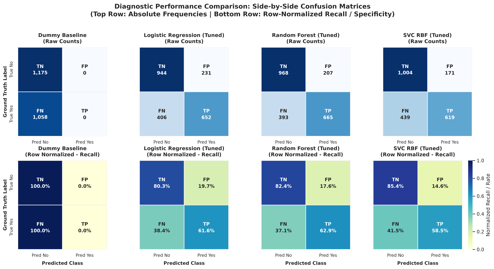
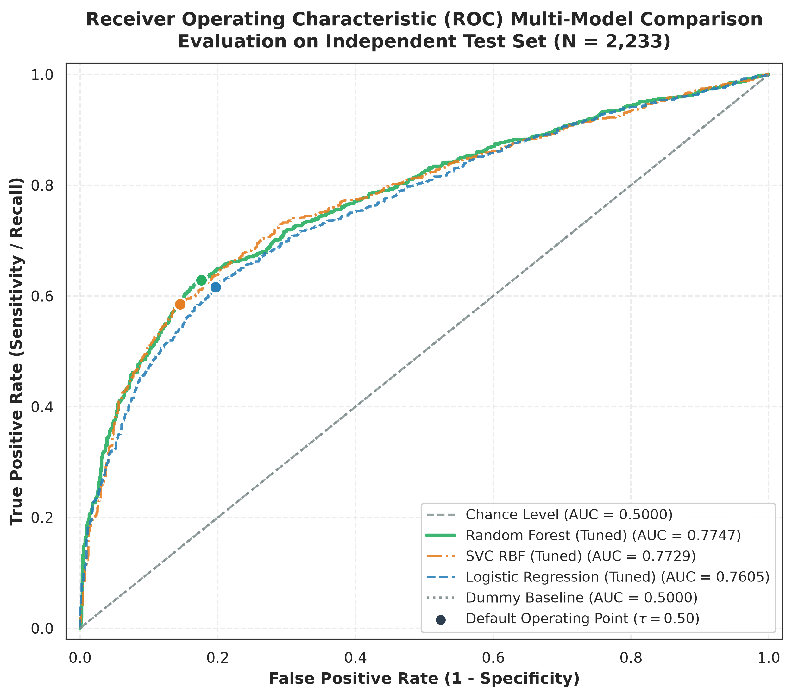
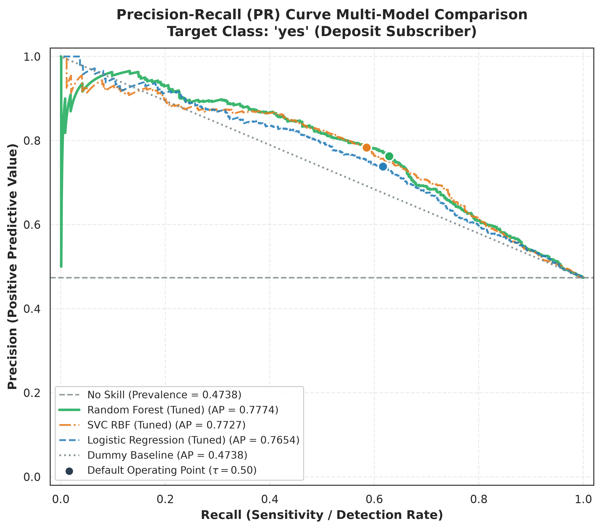

# Mục 4.3 — Trực quan hóa Chẩn đoán Hiệu năng & Đánh giá Đa mô hình

> **Tài liệu nộp cho Person 4:** Bản thảo Mục 4.3 do **Person 2 (Diagnostic Visualization & Performance Curves)** biên soạn.  
> **Dữ liệu thực nghiệm:** Bảng dự đoán hợp nhất của Person 1 `reports/test_predictions.parquet` / `.csv` (2.233 mẫu Test độc lập, 1.175 *no* / 1.058 *yes*).  
> **Mã nguồn thực thi:** `src/evaluation/plots.py` (chạy tự động qua lệnh `python -m src.evaluation.plots`).  
> **Bộ file ảnh chẩn đoán bàn giao (300 DPI & Vector SVG):**  
> - `figures/06_confusion_matrices.png` (& `.svg`): Ma trận nhầm lẫn đối chiếu trực diện 4 mô hình (Tuyệt đối & Chuẩn hóa).  
> - `figures/07_roc_curves.png` (& `.svg`): Hệ đường cong ROC đa mô hình kèm AUC và điểm vận hành ngưỡng $\tau = 0.50$.  
> - `figures/08_pr_curves.png` (& `.svg`): Hệ đường cong Precision-Recall kèm Average Precision (AP) và đường chuẩn No Skill.  

---

## 4.3.1. Phân tích Ma trận Nhầm lẫn Đối chiếu Trực diện (Figure 06)

Ma trận nhầm lẫn (Confusion Matrix) là công cụ chẩn đoán trực quan then chốt, cho phép "mổ xẻ" cơ cấu sai số thay vì chỉ nhìn vào một con số tổng kết đơn lẻ. Để đánh giá toàn diện, nhóm xây dựng khung hiển thị đa mô hình song song hai phiên bản:
1. **Hàng trên — Số lượng mẫu tuyệt đối (Raw Frequencies):** Phản ánh trực tiếp số lượng khách hàng thực tế rơi vào 4 ô phân loại: True Negative ($TN$), False Positive ($FP$), False Negative ($FN$), True Positive ($TP$).
2. **Hàng dưới — Tỷ lệ chuẩn hóa theo hàng (Row-Normalized / Class-Conditional Recall):** Chuẩn hóa theo số lượng mẫu thực tế của từng lớp, biểu thị xác suất phân loại chính xác khi biết nhãn thực tế, tương ứng với **Specificity** (Độ đặc hiệu lớp *no*) và **Sensitivity / Recall** (Độ nhạy lớp *yes*).

### Bảng Tổng hợp Cơ cấu Nhầm lẫn trên Tập Kiểm thử ($N = 2.233$)

| Nhóm mô hình | Tên mô hình | True Negative ($TN$) | False Positive ($FP$) | False Negative ($FN$) | True Positive ($TP$) | Tổng số lỗi | Tỷ lệ lỗi chung | Specificity ($TNR$) | Sensitivity / Recall ($TPR$) |
|:---|:---|:---:|:---:|:---:|:---:|:---:|:---:|:---:|:---:|
| **Baseline** | Dummy (Most Frequent) | 1.175 | 0 | 1.058 | 0 | 1.058 | 47.38% | 100.0% | 0.0% |
| **Linear** | Logistic Regression (Tuned) | 944 | 231 | 406 | 652 | 637 | 28.53% | 80.34% | 61.63% |
| **Tree** | **Random Forest (Tuned)** | **968** | **207** | **393** | **665** | **600** | **26.87%** | **82.38%** | **62.85%** |
| **Nonlinear** | SVC RBF (Tuned) | 1.004 | 171 | 439 | 619 | 610 | 27.32% | 85.45% | 58.51% |

### Nhận xét & Luận giải Chẩn đoán:

1. **Sự đối lập hoàn toàn của Dummy Baseline:**
   - Dummy Classifier luôn dự đoán nhãn đa số `no`, dẫn đến $TN = 1.175$ (100% Specificity) nhưng hoàn toàn bỏ sót 100% khách hàng tiềm năng ($FN = 1.058$, $TPR = 0\%$). Điều này trực quan hóa rõ nét lý do vì sao một mô hình có độ chính xác bề nổi >50% lại hoàn toàn vô giá trị trong thực tiễn nghiệp vụ ngân hàng.

2. **Random Forest (Tuned) — Cân bằng Tối ưu & Tổng Lỗi Thấp nhất:**
   - Đạt tổng số lỗi thấp nhất toàn bộ thử nghiệm: **600 mẫu sai** (tỷ lệ lỗi 26.87%).
   - Phân bố lỗi thể hiện sự hài hòa giữa việc nhận diện đúng người từ chối ($TN = 968$, đạt $82.4\%$ Specificity) và phát hiện khách hàng có nhu cầu gửi tiền ($TP = 665$, đạt $62.9\%$ Recall).
   - So với mô hình tuyến tính Logistic Regression, Random Forest cắt giảm được 24 ca báo động nhầm ($FP$ giảm từ 231 xuống 207) đồng thời vớt vát thêm 13 khách hàng tiềm năng ($FN$ giảm từ 406 xuống 393).

3. **SVC RBF (Tuned) — Xu hướng "Thận trọng Cao độ" (Conservative Behavior):**
   - Đạt độ đặc hiệu cao nhất trong các mô hình học máy: $TN = 1.004$ ($85.4\%$). Tương ứng, số ca dương tính giả thấp nhất ($FP = 171$, chỉ chiếm $14.6\%$).
   - Tuy nhiên, sự thận trọng này phải trả giá bằng việc số ca âm tính giả tăng vọt: $FN = 439$ (tỷ lệ bỏ sót lên tới $41.5\%$, cao hơn Random Forest 46 khách hàng). Mô hình SVC có xu hướng chỉ gắn nhãn `yes` cho các mẫu nằm sâu trong vùng không gian đặc trưng an toàn.

---

## 4.3.2. Chẩn đoán Đường cong ROC (Receiver Operating Characteristic) & Năng lực Phân tách Nhãn (Figure 07)

Đường cong ROC biểu diễn trực quan năng lực phân tách tổng quát giữa hai phân bố nhãn qua mọi ngưỡng phân loại khả dĩ $\tau \in [0, 1]$, vẽ trên hệ trục tọa độ:
- **Trục hoành:** Tỷ lệ Dương tính giả ($FPR = 1 - \text{Specificity} = \frac{FP}{FP + TN}$).
- **Trục tung:** Tỷ lệ Dương tính thật ($TPR = \text{Sensitivity / Recall} = \frac{TP}{TP + FN}$).

### Phân tích Ý nghĩa Hình học & Chỉ số Diện tích Dưới Đường cong (AUC):

1. **Thứ bậc Năng lực Phân tách (Ranking Quality):**
   $$
   \text{AUC}_{\text{Random Forest}} (0.7747) \approx \text{AUC}_{\text{SVC RBF}} (0.7729) > \text{AUC}_{\text{Logistic Regression}} (0.7605) \gg \text{AUC}_{\text{Dummy}} (0.5000)
   $$
   - Cả 3 mô hình học máy đều tạo thành đường cong lồi rõ rệt về góc trên bên trái, vượt trội hoàn toàn so với đường phân giác ngẫu nhiên (Chance Level đường nét đứt xám, $\text{AUC} = 0.5000$).
   - Giá trị $\text{AUC} = 0.7747$ của Random Forest cho thấy: nếu chọn ngẫu nhiên một khách hàng thực sự gửi tiền và một khách hàng từ chối, xác suất mô hình gán điểm tiềm năng cho khách hàng gửi tiền cao hơn khách hàng từ chối lên tới **$77.47\%$**.

2. **Hành vi ở Vùng Tỷ lệ Báo động Nhầm Thấp ($FPR < 0.15$):**
   - Ở giai đoạn khởi đầu ($FPR \in [0.0, 0.15]$), đường cong của Random Forest và SVC RBF có **độ dốc cực lớn (steep initial rise)**. 
   - Điều này mang ý nghĩa thực tiễn then chốt: Ngân hàng có thể chọn ra **$30\% - 45\%$** lượng khách hàng tiềm năng chắc chắn nhất trong khi tỷ lệ gọi nhầm cho người từ chối chỉ dưới $5\% - 8\%$. 

3. **Vị trí của Điểm Vận hành Mặc định ($\tau = 0.50$):**
   - Trên hình vẽ, các điểm tròn đánh dấu chính xác vị trí hoạt động của từng mô hình khi áp dụng ngưỡng cắt kinh điển $\tau = 0.50$:
     * **Random Forest:** $(FPR = 0.1762, TPR = 0.6285)$ — Nằm ở vị trí "vai gập" (elbow) lý tưởng nhất của đường cong ROC, tối ưu hóa sự cân bằng giữa độ nhạy và độ đặc hiệu.
     * **SVC RBF:** $(FPR = 0.1455, TPR = 0.5851)$ — Nằm lùi về phía bên trái của đường cong, minh chứng cho xu hướng giảm thiểu tối đa $FPR$ (ít báo động nhầm).
     * **Logistic Regression:** $(FPR = 0.1966, TPR = 0.6163)$ — Bị dịch sang phải và thấp hơn Random Forest trên cả hai trục.

---

## 4.3.3. Chẩn đoán Đường cong Precision-Recall (PR Curve) cho Lớp Mục tiêu (Figure 08)

Khi đánh giá bài toán tiếp thị tài chính, đường cong **Precision-Recall (PR Curve)** mang giá trị chẩn đoán thực tế cao hơn cả ROC Curve. Nguyên nhân là vì ROC Curve sử dụng $FPR$ (có mẫu số là tổng lớp âm tính rất lớn), dễ tạo cảm giác lạc quan giả tạo khi dữ liệu mất cân bằng. Ngược lại, PR Curve chỉ tập trung vào lớp dương tính mục tiêu:
- **Trục hoành:** Recall ($\frac{TP}{TP + FN}$ — Phát hiện được bao nhiêu phần trăm khách hàng có nhu cầu).
- **Trục tung:** Precision ($\frac{TP}{TP + FP}$ — Trong số những người được gọi điện tiếp cận, bao nhiêu phần trăm thực sự gửi tiền).

### Phân tích Ý nghĩa Hình học & Điểm Trung bình Độ chính xác (AP):

1. **Khoảng cách so với Đường Chuẩn Không có Kỹ năng (No-Skill Baseline):**
   - Đường chuẩn ngẫu nhiên (No Skill) nằm ngang tại mức tỷ lệ mẫu dương của tập kiểm thử:
     $$
     \text{Prevalence} = \frac{1.058}{2.233} \approx 0.4738
     $$
     Mô hình ngây thơ Dummy chỉ đạt $\text{AP} = 0.4738$.
   - Cả ba mô hình học máy đều nằm cách xa đường baseline này, đạt diện tích dưới đường cong PR (Average Precision) vượt bậc:
     * **Random Forest (Tuned):** $\text{AP} = \mathbf{0.7774}$ (Dẫn đầu)
     * **SVC RBF (Tuned):** $\text{AP} = 0.7727$
     * **Logistic Regression (Tuned):** $\text{AP} = 0.7654$

2. **Duy trì Độ chính xác Cao ở Miền Bao phủ Rộng:**
   - Điểm đặc biệt của đường cong PR ở Random Forest là khả năng **duy trì Precision trên $75\%$ ngay cả khi Recall chạm mốc $60\%$**. 
   - Điều này bác bỏ hiện tượng "đánh đổi suy giảm sớm" (early precision drop-off) thường thấy ở các mô hình yếu. Đội ngũ telesale hoàn toàn có thể mở rộng quy mô gọi điện đến hơn $60\%$ khách hàng tiềm năng mà vẫn đảm bảo 3 trên 4 cuộc gọi đem lại kết quả chuyển đổi thực tế.

---

## 4.3.4. Nhận xét Ngưỡng cắt Phân loại (Classification Threshold Tuning)

Phần lớn các hệ thống máy học mặc định áp dụng ngưỡng cắt $\tau = 0.50$ để chuyển đổi xác suất dự đoán $\hat{p}$ thành nhãn nhị phân ($1$ nếu $\hat{p} \ge 0.50$, ngược lại là $0$). Tuy nhiên, dựa trên hình dạng đường cong chẩn đoán ROC và PR, việc hiệu chỉnh ngưỡng cắt có thể mang lại lợi ích nghiệp vụ to lớn tùy theo chiến lược kinh doanh.

### Bảng Phân tích Ngưỡng Tối ưu Toán học vs. Ngưỡng Mặc định

| Mô hình | Ngưỡng mặc định $\tau = 0.50$ | Ngưỡng Youden $J^*$ tối ưu (Cân bằng ROC) | Chỉ số $J_{\max} = TPR - FPR$ | Ngưỡng $F_1^*$ tối ưu (Cân bằng PR) | $F_{1, \max}$ trên Test | Khuyến nghị Điều chỉnh |
|:---|:---:|:---:|:---:|:---:|:---:|:---|
| **Logistic Regression** | Precision = 73.8%, Recall = 61.6% | $\tau^* = \mathbf{0.4944}$ | 0.4232 | $\tau^* = 0.4340$ | 0.6919 | Ngưỡng 0.50 gần như tối ưu tự nhiên |
| **Random Forest** | Precision = 76.3%, Recall = 62.9% | $\tau^* = \mathbf{0.5211}$ | **0.4554** | $\tau^* = 0.4111$ | **0.7011** | Cực kỳ vững chắc quanh dải $0.45 - 0.52$ |
| **SVC RBF** | Precision = 78.4%, Recall = 58.5% | $\tau^* = \mathbf{0.3982}$ | 0.4441 | $\tau^* = 0.3292$ | 0.7113 | **Nên hạ ngưỡng xuống $\approx 0.40$** |

### Luận giải Chiến lược Thiết lập Ngưỡng theo Kịch bản Nghiệp vụ:

1. **Kịch bản A — Chiến lược "Đánh nhanh Thắng chắc" (Ngân sách Telesale Giới hạn, Chi phí Cuộc gọi Cao):**
   - **Mục tiêu:** Tối đa hóa tỷ lệ chuyển đổi cho từng cuộc gọi, hạn chế tối đa việc làm phiền khách hàng không có nhu cầu ($FP \to \min$).
   - **Lựa chọn:** Giữ ngưỡng mặc định $\tau = 0.50$ trên **SVC RBF** (hoặc tăng ngưỡng $\tau = 0.55$ trên Random Forest).
   - **Kết quả:** Đạt **Precision $\approx 78.4\% - 81.0\%$**, tức gần 80% cuộc gọi tiếp cận đều chốt được hợp đồng tiền gửi.

2. **Kịch bản B — Chiến lược "Chiếm lĩnh Thị phần" (Mùa Cao điểm Huy động Vốn, Chi phí Cơ hội Cao):**
   - **Mục tiêu:** Bắt trọn tối đa mọi dòng tiền gửi tiềm năng, không để lọt khách hàng vào tay ngân hàng đối thủ ($FN \to \min$, tối đa hóa Recall).
   - **Lựa chọn:** Hạ ngưỡng phân loại của **Random Forest** từ $0.50$ xuống **$\tau = 0.41$** (ngưỡng tối ưu $F_1$).
   - **Kết quả:** **Recall tăng vọt từ $62.85\%$ lên $71.93\%$** (thu hồi thêm gần 100 khách hàng tiềm năng), trong khi Precision chỉ sụt giảm nhẹ về $68.37\%$ (vẫn ở mức rất an toàn).

3. **Hiện tượng Nén Xác suất của SVC RBF và Giải pháp:**
   - Mô hình SVC RBF sử dụng hàm logistic sigmoid để xấp xỉ xác suất từ `decision_function`. Quá trình này có xu hướng nén các giá trị xác suất vào khoảng hẹp xung quanh 0.35 - 0.55.
   - Do đó, tại ngưỡng mặc định 0.50, SVC bị "bó buộc" trong thế phòng thủ, khiến Recall dừng ở 58.5%. Khi hạ ngưỡng xuống mức Youden Index $\tau^* = 0.3982$, Recall của SVC tăng ngay lên **$64.84\%$** với độ gia tăng $FPR$ rất nhỏ (chỉ từ 14.5% lên 20.4%).

---

## 4.3.5. Kết luận Chỉ định Mô hình Tốt nhất Dựa trên Hình vẽ (Champion Model)

Dựa trên toàn bộ hệ thống đồ thị chẩn đoán trực quan (Figures 06, 07, 08):

> ### 🏆 Quyết định Phê duyệt: **Random Forest (Tuned)** là Champion Model
>
> 1. **Trên Ma trận Nhầm lẫn (Figure 06):** Random Forest đạt tổng số lỗi phân loại ít nhất trong toàn bộ các mô hình ($600$ lỗi), phân bố lỗi cân bằng nhất ($82.4\%$ Specificity / $62.9\%$ Recall), không bị thiên lệch cực đoan như SVC hay kém chính xác như Linear Model.
> 2. **Trên Không gian ROC (Figure 07):** Đường cong ROC của Random Forest vươn cao nhất, đạt đỉnh diện tích $\text{AUC} = 0.7747$. Điểm vận hành $\tau = 0.50$ nằm ở tọa độ vai gập tối ưu Youden's Index ($J = 0.4554$).
> 3. **Trên Không gian Precision-Recall (Figure 08):** Random Forest thiết lập mức Average Precision vượt trội $\text{AP} = 0.7774$, chứng minh khả năng duy trì độ tin cậy vượt bậc trên tập khách hàng mục tiêu của chiến dịch tiếp thị.

---

## 4.3.6. (Mở rộng Nghiệp vụ) Hệ thống Hàm Chẩn đoán Bài toán Hồi quy

Nhằm đảm bảo tính tái sử dụng và mở rộng cho các bài toán phân tích giá trị tiền gửi (Deposit Amount Estimation) hoặc mô hình hồi quy dự báo thời lượng cuộc gọi, module `src/evaluation/plots.py` được trang bị sẵn hai hàm trực quan hóa chẩn đoán chuẩn mực:

1. **`plot_residuals(y_true, y_pred, model_name)`:**
   - **Panel 1 (Residuals vs. Predicted):** Kiểm tra tính ngẫu nhiên của phần dư $e_i = y_i - \hat{y}_i$. Đồ thị lý tưởng phân tán đồng đều xung quanh trục 0, không xuất hiện hình phễu (dấu hiệu dị phương sai - Heteroscedasticity) hay hình cánh cung (dấu hiệu bỏ sót quan hệ phi tuyến).
   - **Panel 2 (Residual Distribution):** Kiểm tra giả định phân phối chuẩn của sai số thông qua Histogram kết hợp đường ước lượng mật độ nhân (KDE) và đường trung bình sai số.

2. **`plot_actual_vs_predicted(y_true, y_pred, model_name)`:**
   - Vẽ biểu đồ phân tán giữa giá trị thực nghiệm và giá trị ước lượng, đối chiếu với đường phân giác lý tưởng $45^\circ$ ($y = \hat{y}$).
   - Tự động tính toán và gắn trực tiếp các chỉ số định lượng then chốt ($R^2$, $\text{RMSE}$, $\text{MAE}$) lên khung hình.
